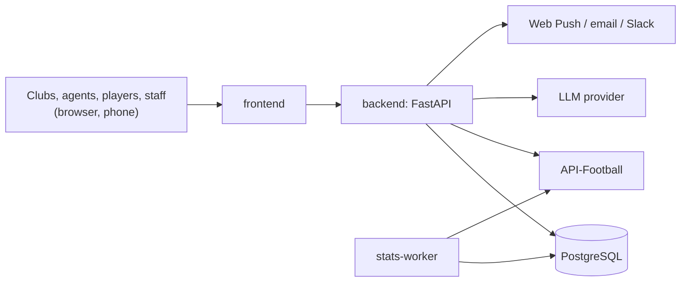

# TransferX Product Specification

## Purpose

The entry point for TransferX's documentation: a short, accurate description of what the product is today, and an index of everything else. Read this first.

It's an outline with pointers. Detail lives in the linked documents, each with one job, so a fact is changed in one place.

## Scope

In scope: what TransferX is today, grounded in the code, and where to find everything.
Out of scope: implementation detail (`architecture/`, `engineering/`), the backlog (the [roadmap](./product/roadmap.md) and Linear), business strategy (`business/`).

## Table of Contents

- [What TransferX is](#what-transferx-is)
- [Current state](#current-state)
- [Documentation map](#documentation-map)
- [System diagram](#system-diagram)
- [Related documents](#related-documents)

## What TransferX is

TransferX is a web platform for professional football transfers. It connects **selling clubs**, **buying clubs**, **agents** and **players** around one structured deal:
- **Before an offer:** a club enquires about a player, or lists one (open to offers, or by auction).
- **The offer:** buying clubs make offers that carry the full terms (fee, wage, payment schedule, add-ons, sell-on, or a loan), and the clubs counter.
- **The deal:** an accepted offer becomes a deal. The player's agent negotiates commission, the player (or his agent) consents to personal terms, and the clubs complete the paperwork through to completion.

**Around the deal:**
- club finance with reserved, committed and spent budgets, and spending approvals;
- squad management, scouting and a fair-value model;
- an AI assistant that advises and never acts;
- **Lite mode**, every club member's default home, with the full app a button away;
- phone notifications;
- an admin panel with a full audit trail.

> **TODO:** Replace this with an approved product description once [`business/vision.md`](./business/vision.md) has one. It's derived from the code and must stay accurate to what's built.

## Current state

| Fact | Value | Source |
|---|---|---|
| Backend | Python 3.12, FastAPI, SQLAlchemy (async), PostgreSQL | [`architecture/backend-architecture.md`](./architecture/backend-architecture.md) |
| Frontend | React 19, Vite, TypeScript, Tailwind CSS v4, TanStack Query | [`architecture/frontend-architecture.md`](./architecture/frontend-architecture.md) |
| Migrations | Alembic, head `0102` (local; Railway at `0101` until the next deploy) | [`engineering/database-migrations.md`](./engineering/database-migrations.md) |
| Accounts | Club (owner and four staff roles), Agent, Player; TransferX staff are superusers. Everyone joins by invitation | [`product/personas.md`](./product/personas.md) |
| Deal stages | AGREEMENT → AGENT_NEGOTIATION (with a mandate) → PERSONAL_TERMS → PAPERWORK → CONFIRMED → COMPLETED; any open deal can collapse | [`product/workflows/transfer-lifecycle.md`](./product/workflows/transfer-lifecycle.md) |
| Deal types | PERMANENT and LOAN (offered); FREE_TRANSFER and PRE_CONTRACT (from the signing paths) | [`product/workflows/transfer-lifecycle.md`](./product/workflows/transfer-lifecycle.md) |
| Working surfaces | The Transfers board with one conversation per transfer; the dashboard; Lite mode, the default for club members (Lite decides, the full app operates) | [product ADR 0008](./product/decisions/0008-transfers-board-one-way-to-buy-lite-decides.md) |
| Notifications | In-app, email (per type and the daily digest), phone push (tiers, quiet hours, morning summary, decision sheets, email fallback) | [`feature_spec/mobile-notifications/`](./feature_spec/mobile-notifications/README.md) |
| AI | Advises, never acts (ADR 0006); Ask TransferX answers as an analyst from read-only, club-scoped tools | [`feature_spec/ai-analyst/`](./feature_spec/ai-analyst/README.md) |
| Data | API-Football, refreshed at 17:00 and 22:00 UK by the `stats-worker`; valuations (`market-v2`) recomputed daily. Real-world moves are flagged and applied only by staff ([product ADR 0009](./product/decisions/0009-real-world-moves-flagged-applied-by-staff.md)) | [`feature_spec/scheduled-data-refresh.md`](./feature_spec/scheduled-data-refresh.md) |
| Operations | Railway, deploying `main` automatically: `backend`, `frontend`, `Postgres`, `stats-worker`. A demo environment, not production. Admin Jobs, Errors and Health | [`operations/environments-and-deployment.md`](./operations/environments-and-deployment.md) |
| Current plan | Q4 2026 phased plan: Phases 0, 1 and 3 done (except the phone test and two-factor sign-in) | [`product/roadmap.md`](./product/roadmap.md) |
| Built state and gaps | Verified by area, with known gaps | [`IMPLEMENTATION_STATUS.md`](./IMPLEMENTATION_STATUS.md) |

## Documentation map

### Business
*Why it exists, who it serves commercially, how it makes money. Mostly open decisions.*

- [`business/README.md`](./business/README.md)
- [`business/vision.md`](./business/vision.md): mission and problem statement (TODO)
- [`business/target-users-and-market.md`](./business/target-users-and-market.md)
- [`business/business-model.md`](./business/business-model.md): pricing (TODO, a decision needed)
- [`business/glossary.md`](./business/glossary.md): the canonical definitions of domain terms

### Product
*What we build, for whom, in what order.*

- [`product/README.md`](./product/README.md)
- [`product/roadmap.md`](./product/roadmap.md): where the plan stands
- [`product/personas.md`](./product/personas.md)
- [`product/workflows/`](./product/workflows/README.md): [transfer lifecycle](./product/workflows/transfer-lifecycle.md), [negotiation and offers](./product/workflows/negotiation-and-offers.md), [agent representation](./product/workflows/agent-representation.md), [deal completion](./product/workflows/deal-completion.md)
- [`product/decisions/`](./product/decisions/README.md): product decision records (0001–0009)

### Architecture
*How the system is designed.*

- [`architecture/system-overview.md`](./architecture/system-overview.md): stack, services, external services, diagram
- [`architecture/backend-architecture.md`](./architecture/backend-architecture.md): modules and background jobs
- [`architecture/frontend-architecture.md`](./architecture/frontend-architecture.md): structure, route guards, state
- [`architecture/data-model.md`](./architecture/data-model.md): entities and relationships
- [`architecture/authentication-and-permissions.md`](./architecture/authentication-and-permissions.md): sign-in, sessions, roles, capabilities, admin safeguards
- [`architecture/decisions/`](./architecture/decisions/README.md): architecture decision records (0001–0008)

### Design system
*The visual and interaction rules every screen follows.*

- [`design-system/README.md`](./design-system/README.md): the principle, four tiers, "whose move", settled decisions
- [`design-system/RULES.md`](./design-system/RULES.md), [`TOKENS.md`](./design-system/TOKENS.md), [`RESPONSIVE.md`](./design-system/RESPONSIVE.md), [`SCREENS.md`](./design-system/SCREENS.md)

### Engineering
*Working in the codebase.*

- [`engineering/getting-started.md`](./engineering/getting-started.md) (commands in the root [`README.md`](../README.md))
- [`engineering/coding-standards.md`](./engineering/coding-standards.md)
- [`engineering/testing-strategy.md`](./engineering/testing-strategy.md)
- [`engineering/database-migrations.md`](./engineering/database-migrations.md)
- [`engineering/api-reference.md`](./engineering/api-reference.md)

### Operations
*Running it.*

- [`operations/environments-and-deployment.md`](./operations/environments-and-deployment.md): Railway, the `stats-worker`, demo accounts
- [`operations/monitoring-and-observability.md`](./operations/monitoring-and-observability.md): Jobs, Errors, Health, Slack
- [`operations/incident-response.md`](./operations/incident-response.md)

### Security & Compliance

- [`security-and-compliance/permissions-model.md`](./security-and-compliance/permissions-model.md): who sees what, and known gaps
- [`security-and-compliance/data-privacy-and-legal.md`](./security-and-compliance/data-privacy-and-legal.md)

### Feature specs
*Build specifications. Once shipped, the documents above are the truth and the spec keeps the decisions, rules and deviations.*

- [`feature_spec/README.md`](./feature_spec/README.md): every spec with its verified status

### Tracking documents

- [`CHANGELOG.md`](./CHANGELOG.md): what changed, in order
- [`IMPLEMENTATION_STATUS.md`](./IMPLEMENTATION_STATUS.md): what's built now, and known gaps
- [`SESSION_HANDOVER.md`](./SESSION_HANDOVER.md): the note for the next working session

## System diagram

More in [`architecture/system-overview.md`](./architecture/system-overview.md).

## Related documents

- [`README.md`](./README.md): how the documentation is organised, and its conventions
- [`../.claude/skills/`](../.claude/skills/): the project skills that encode these conventions
