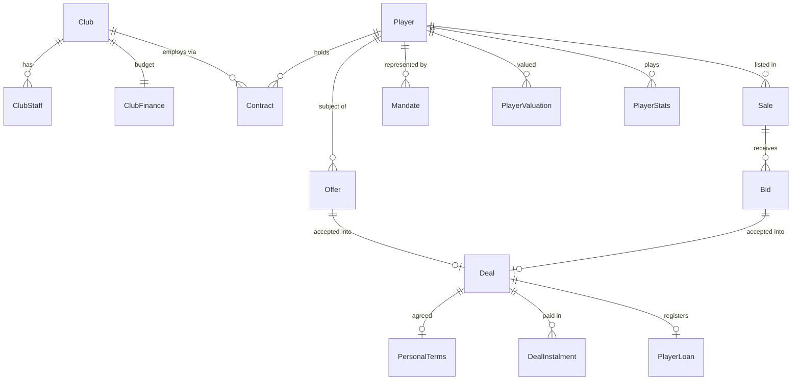

# Data Model

## Purpose

TransferX's entities, which module owns each, and how the core ones relate. The technical counterpart to [`../business/glossary.md`](../business/glossary.md).

## Scope

In scope: entities and relationships.
Out of scope: column-level schema (the migrations in `backend/migrations/versions/` are the source of truth) and business definitions (the glossary).

## Table of Contents

- [Entities by module](#entities-by-module)
- [Core relationships](#core-relationships)
- [Rules worth knowing](#rules-worth-knowing)
- [Related documents](#related-documents)

## Entities by module

Verified against `backend/app/*/models.py` on 2026-10-11.

| Module | Entities |
|---|---|
| `auth` | `User`, `RefreshToken` (sessions and signed-in devices), `PasswordResetToken`, `AgentProfile`, `PlayerProfile` |
| `clubs` | `Club`, `ClubFinance` (budget: reserved, committed, spent; approval thresholds), `ClubStaff`, `ClubInvitation`, `ClubStaffInvitation`, `PlayerInvitation`, `PlayerSearchView` |
| `players` | `Player`, `Contract`, `PlayerTransfer` (history), `PlayerInjury`, `PlayerView` (profile views, counts per club per day) |
| `sales` | `Sale` (a listing), `Bid`, `SaleEvent` |
| `offers` | `Offer` (permanent or loan, possibly anonymous), `OfferMessage`, `OfferEvent` |
| `enquiries` | `Enquiry`, `EnquiryMessage` |
| `deals` | `Deal`, `DealClause`, `DealInstalment`, `PersonalTerms`, `MedicalCheck`, `DealNote`; the deal room: `DealTermsVersion`, `DealComment`, `DealAttachment` |
| `loans` | `PlayerLoan` |
| `agents`, `mandates` | `AgentDealInvitation`, `AgentNegotiation`, `NegotiationMessage`, `AgentCommission`; `Mandate`, `ClientAlert` |
| `approvals` | `PendingApproval` |
| `lite` | `UserPreference`, `HeldAction` (sends held for undo), `ActionToken` (decisions from email) |
| `notifications` | `Notification`, `NotificationPreference`, `PushSubscription`, `PushDelivery` |
| `scouting` | `Shortlist`, `ShortlistItem`, `PlayerInterest` |
| `valuation` | `PlayerValuation` (append-only; `inputs_json` replays each value) |
| `stats` | `PlayerStats` (per competition, season and club), `PlayerStatsSnapshot`, `PlayerForm`, `PlayerInjuryFixture`, `PlayerFixtureRating`, `TeamSeasonFixtures`, `VendorSyncState`, `VendorSyncRun`, `VendorFetchLog` |
| `world` | `WorldLeague` (the competitions the data refresh syncs, with their current season), `WorldTeam` |
| `transfer_window` | `TransferWindow` |
| `verification` | `VerificationRequest` |
| `ai` | `AssistantQuery` (every question asked), `AISuggestionEvent` |
| `audit` | `AuditEvent` |
| `analytics` | `AnalyticsEvent` |
| `monitoring` | `JobRun`, `JobRunLog`, `ErrorIssue`, `ErrorEvent`, `RequestMinute` |
| `common` | `SchedulerJobRun` (each in-app job's last run) |
| `fixtures` | `Fixture` |

## Core relationships

## Rules worth knowing

- **Ownership.** A player belongs to the club holding his active TransferX `Contract`. Vendor data never overrides that ([ADR 0001](./decisions/0001-vendor-data-never-overrides-transferx-contract.md)).
- **Status.** `Player.status` tells a free agent apart from a player at a club outside TransferX ([ADR 0003](./decisions/0003-player-status-distinguishes-external-clubs.md)).
- **Loans.** A loan suspends the parent's contract rather than ending it. The parent stays the owner ([ADR 0005](./decisions/0005-loan-registration-separate-from-ownership.md)).
- **Money.** Every money action moves `ClubFinance` through reserve, then commit, then spend, under row locks.
- **One listing.** A player has at most one open listing (a partial unique index).
- **Append-only.** Valuations and audit events are never updated in place.

## Related documents

- [`../business/glossary.md`](../business/glossary.md): plain-language definitions
- [`backend-architecture.md`](./backend-architecture.md): the modules
- [`../engineering/database-migrations.md`](../engineering/database-migrations.md): how the schema changes
