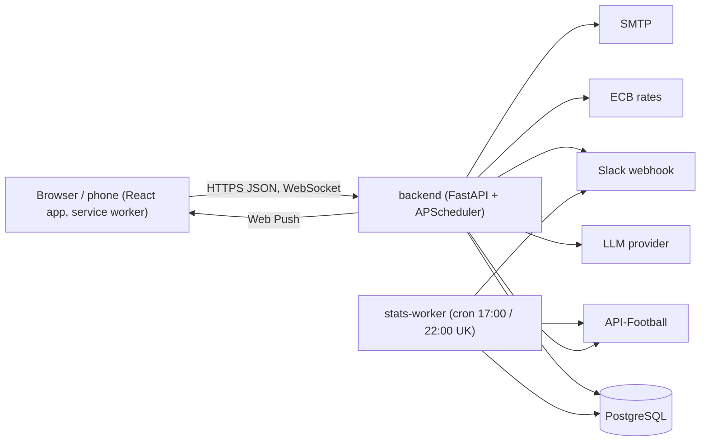

# System Overview

## Purpose

A high-level picture of TransferX's stack and how its pieces fit together: the entry point before [`backend-architecture.md`](./backend-architecture.md) or [`frontend-architecture.md`](./frontend-architecture.md).

## Scope

In scope: the stack, the running services, and how they talk to each other and to outside services.
Out of scope: module detail (the two architecture docs above), entities ([`data-model.md`](./data-model.md)).

## Table of Contents

- [Stack](#stack)
- [Services](#services)
- [External services](#external-services)
- [Diagram](#diagram)
- [Related documents](#related-documents)

## Stack

| Layer | Technology |
|---|---|
| Backend | Python 3.12, FastAPI, SQLAlchemy 2 (async), Alembic, Pydantic 2 |
| Frontend | React 19, Vite 6, TypeScript 5, Tailwind CSS v4, TanStack Query 5, React Router 7 |
| Database | PostgreSQL (SQLite in memory for the backend test suite) |
| Real-time | WebSocket (`/ws`) for live refresh; Web Push for phones |
| Background work | APScheduler inside the web app for short jobs; a separate cron service (`stats-worker`) for the twice-daily data refresh |
| AI | LiteLLM, model set by `LLM_MODEL` |

## Services

| Service | Locally (Docker Compose) | On Railway |
|---|---|---|
| Database | `db` (Postgres) | `Postgres` |
| API | `api`: FastAPI on port 8001. Mounts the source; runs migrations on start | `backend`: built from `backend/Dockerfile`; runs migrations on start |
| Frontend | `frontend`: a built production image on port 5173, so UI changes need a rebuild | `frontend` |
| Data refresh | Run by hand: `python -m app.jobs.daily_refresh --force` | `stats-worker`: cron at 17:00 and 22:00 UK ([operations](../operations/environments-and-deployment.md#the-stats-worker-service-scheduled-data-refresh)) |
| Email | `mailpit` catches all local mail | Not set up (no SMTP variables yet) |

## External services

| Service | Used for | Code |
|---|---|---|
| API-Football (api-sports.io) | Players, season stats, injuries, match ratings, transfer history | `app/vendor/` |
| LLM provider (through LiteLLM) | The AI assistant and Ask TransferX | `app/ai/` |
| ECB daily rates | Currency estimates shown beside pound amounts | `app/fx/` |
| Web Push (VAPID) | Phone notifications | `app/notifications/push.py` |
| SMTP | Email notifications, digests, invitations, password reset | `app/notifications/email.py` |
| Slack Incoming Webhook | Data-refresh run messages and monitoring alerts | `app/common/slack.py` |

## Diagram

## Related documents

- [`backend-architecture.md`](./backend-architecture.md): backend modules and jobs
- [`frontend-architecture.md`](./frontend-architecture.md): frontend structure
- [`../engineering/getting-started.md`](../engineering/getting-started.md): running it locally
- [`../operations/environments-and-deployment.md`](../operations/environments-and-deployment.md): Railway
