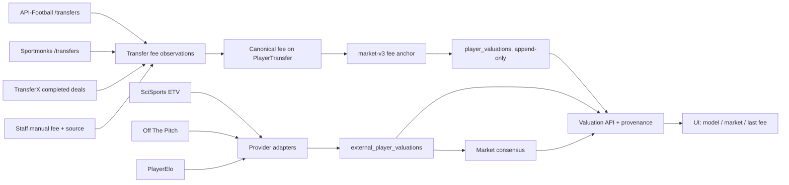

# Feature Spec: Licensed Market Data and a Last-Fee Anchor for Valuations

## What was built, and how it differs from this spec

Phase 1 — the last-fee anchor, `market-v3` and the fee display — is implemented in a simplified form. The anchor itself is **switched off in production** (`VALUATION_FEE_ANCHOR_ENABLED=false`) until its backtest has been run against production and reviewed. The licensed market-value phases are not built.

| This spec | What shipped |
|---|---|
| `transfer_fee_observations` table and canonical fee columns on `player_transfers` | **Not built.** Staff-entered fees are ordinary `player_transfers` rows with `vendor = 'manual'`, carrying `fee_basis`, `source_note`, `source_url` and `entered_by_user_id` (migration `0114`). API-Football rows and completed TransferX deals are read directly. A staff row suppresses the vendor's figure for the same move when the dates are within 60 days |
| Observations with `is_reported` / `verified_at` / source priority | Only `vendor` and the staff columns distinguish provenance. Staff rows weigh 0.80 in the anchor (`MANUAL`); API-Football reports weigh 0.65 (`REPORTED`); completed TransferX deals weigh 1.00 (`TRANSFERX`) |
| `fee_basis` per observation | Stored on the row as `PERMANENT` or `RELEASE_CLAUSE`; a release clause carries basis weight 0.40 |
| `player_valuations` fee columns (`fee_anchor_value`, `last_fee_gbp`, …) | **Not added.** The result lives in `inputs_json["fee_anchor"]` and `inputs_json["features"]["last_fee"]`, which replay the stored row exactly; `model_version = 'market-v3'` marks the version |
| Contract and availability at the transfer date in the anchor | **Assumed neutral** (1.00), because historical contract and availability state is not stored. The anchor applies the player's current contract and availability factors |
| Fewer than 450 minutes before the move → no anchor | Implemented. Evidence weight is `min(1, minutes / 1800)`; when **no** pre-move stats are on record the evidence weight is **0.60**, not zero |
| Outgrown-fee rule: age under 25, fee older than 2 years, score improvement ≥ 15 points | Implemented as age ≤ 24, at least 2 years since the fee, and a score gain of at least 15. The anchor is skipped and `fee_anchor.reason` says why |
| A later free move | Implemented. A permanent free transfer after the fee sets `later_free_move`; the anchor is skipped with "He has moved on a free transfer since the {year} fee", because the old fee no longer describes his market. Loans and undisclosed ("N/A") moves do not trigger it, and the "Last transfer" display still shows the last **paid** move |
| Feature flag; staff-first rollout | **One switch, off by default:** `VALUATION_FEE_ANCHOR_ENABLED`. While it is `false` the fee is not loaded into the features, and rows are computed, labelled (`market-v2`) and replayed exactly as before; staff-entered fees and the fee's provenance work either way. It ships off because the production backtest and outcome report have not been run. Set it to `true` on the API and `stats-worker` services once they have been reviewed; `market-v3` rows are written from the next recompute |
| `external_values`, `market_consensus`, provider adapters | Not built. PlayerElo is the recommended pilot and the next step |
| Admin → Data providers page | Only a **Transfer fees** card on the admin player page: list, add and delete staff rows, each audited |

Exposed to clients as `fee_anchor` on valuation responses (`applied`, `factor`, `weight`, `anchor_value`, `fee_today`, `reason`) and as `basis` on `last_transfer`, whose `source` reads "Staff-entered" for a staff row. `source_note` and `source_url` are for staff only and never leave the admin endpoints (changed on review, 2026-11-22: the player ledger is open to signed-out visitors, and a note may hold internal remarks). The admin endpoints are `GET`/`POST`/`DELETE /admin/players/{player_id}/transfer-fees` (superuser only). `DELETE` takes a JSON body `{"reason"}` (5 to 500 characters), recorded in the audit trail. An add or delete recomputes that player's valuation.

## Purpose

Make the valuation a club sees closer to how the transfer market actually prices a player, without scraping and without giving up TransferX's independent estimate.

Three changes, in order of leverage:

1. **Use the fees TransferX already holds.** Show a player's last permanent transfer fee next to the model value, and use it as a *fee anchor* — a bounded, explained adjustment to the model, not a replacement.
2. **Add one or more licensed market-value feeds** behind a provider-agnostic adapter. Store each provider's value, range, date and model version separately. Show a market consensus beside the TransferX model, never instead of it.
3. **Keep the realised fee as the ground truth for calibration.** Every provider and every model version is scored against actual completed fees, on a time-based holdout, before it is shown to users.

This is a direct response to the 30 October 2026 demo feedback: Declan Rice shown at £45m against a £105m last fee, Cole Palmer at £33m against a £40m fee. The problem is not only model accuracy; it is that the product shows one unexplained number while the audience already knows a real fee. The fix is provenance and a market cross-check, not a single "true value".

## Why now

| Evidence | What it means |
|---|---|
| `market-v2` is calibrated but still misses: 31% of production fees within ±25%, median bias −9.4%; fees £25m+ under-predicted by 37%, fees under £5m over-predicted by 118% ([calibration](./model.md#calibration-archetypes-not-a-backtest)) | The model is defensible but not yet demo-credible at the top of the market |
| 309 of 532 contracted players already have a transfer fee on record (30 Oct feedback; verify in production) | The cheapest accuracy win is already in the database and is simply not shown |
| API-Football `/transfers` gives last fees but no current market value | It can anchor, but it cannot provide a live market estimate |
| Transfermarkt has no official API and its terms prohibit bots, scraping and text/data mining; database rights are reserved | Scraping is a legal and operational risk; the existing prototype adapter must stay dev-only |
| Sportmonks does not publish a player market-value field; its transfer endpoint carries an `amount` | Sportmonks is a fee/statistics source, not a valuation source — correcting the 30 Oct assumption before we buy |
| The current `ETVAdapter` points at `api.etv.football`, which did not resolve when checked on 2026-10-31, and assumes an undocumented response shape | The existing ETV integration is speculative; it must not be treated as "almost done" |

## What "more accurate" means

Accuracy is measured against **realised transfer fees**, not against another provider's opinion. The primary metrics:

| Metric | Current (`market-v2`) | Target after this plan |
|---|---|---|
| Fees within ±25% | 31.0% | ≥ 45% |
| Fees within ±50% | 44.0% | ≥ 60% |
| Median bias | −9.4% | within ±7% |
| £25m+ fees within ±25% | Under-predicted by 37% | Improve by ≥ 10 points without worsening other bands |
| Share of contracted players with a displayed reason when no value exists | Not measured | ≥ 98% |

Guardrails:

- No segment (position, league tier, age band, fee band) may get worse by more than 5 percentage points.
- A provider is never treated as ground truth. Backtests use realised fees only.
- If the model and the market disagree, the product shows the disagreement. It does not average it away.

## The three signals and their jobs

The conversation mixes three different things. Keeping them separate is the core design decision.

| Signal | What it is | Examples | Its job | It must never be |
|---|---|---|---|---|
| **Realised fee** | What a club actually paid, reported or verified | API-Football `/transfers`, Sportmonks transfer `amount`, completed TransferX deals, staff-entered fee with a source | Fee anchor; ground truth for backtests; the "last transfer" line in the UI | Used as the current value without adjustment for age, contract, form and time |
| **External market value** | A licensed provider's opinion of what the player is worth now | SciSports ETV (FootballTransfers), Off The Pitch, PlayerElo | A cross-check, a coverage fill and a market consensus | Allowed to overwrite TransferX's `fair_value`, or to be described as "the true value" |
| **TransferX fair value** | Our own deterministic model | `market-v2` today; `market-v3` with the fee anchor | The independent second opinion — the product's differentiator; the fallback when no provider covers a player | Blended silently with provider values, or presented as fact |

> **Product principle:** TransferX sells an independent second opinion. Buying a market value and displaying it as our own would remove the differentiator and create vendor lock-in. Buying it and showing it *beside* our model keeps both.

## Provider landscape (researched 2026-10-31)

All pricing is indicative and must be confirmed in a written quote. "Quote-only" means no public price list was found.

| Provider | Official API / licence | Current market value? | Transfer fees? | Coverage claimed | Cadence | Indicative price | Verdict |
|---|---|---|---|---|---|---|---|
| **API-Football** (existing) | Yes, paid plan | **No** | Yes, last transfer fee on `/transfers` | Broad; 11 competitions synced in production | Twice daily (existing) | Already paid | Keep. The fee source and stats backbone |
| **Sportmonks** | Yes, licensed API | **No** — no market-value field in the Player entity | Yes, transfer `amount` (structured) | 2,300+ leagues on top tiers | Real-time / daily | €29–€249/mo public plans; enterprise custom | Fee/statistics fallback only. **Not a valuation provider** |
| **SciSports ETV** (via FootballTransfers) | Yes, JSON API, contact-form licensing | **Yes** — ETV, range, history | Indirectly, via model | 240,000+ players, 250+ leagues | Monthly | Quote-only; enterprise | **Recommended primary market-value provider**, subject to quote and licence |
| **Off The Pitch Player Valuation** | Yes, API; enterprise sales | **Yes** — Expected Transfer Value and Fair Market Value | Yes, as a model input | 10,000+ players, 34 leagues | Monthly | Quote-only | **Recommended second quote / independent cross-check** |
| **PlayerElo** | Yes, self-serve, commercial licence on Business | **Yes** — `/v1/players/{id}/value` | Ratings, not fees | 79,000+ players, 176 competitions | Daily | €19 / €49 / €199 per month; Business includes commercial licence and SLA | **Recommended pilot and low-cost fallback**; quality unproven, treat as a third opinion |
| **TransferRoom** | Club API, sales-led | Yes, estimated transfer value | Yes | Club network | Not published | Not published | **Not recommended**: a competing transfer marketplace; unlikely to licence to TransferX |
| **Transfermarkt** | **No official API or public licence scheme**; terms prohibit scraping and TDM | Yes, but not licensed | Yes, but not licensed | Huge | Continuous | No public licence | **Do not integrate.** Written permission only; keep the existing adapter dev-only |
| **Football Benchmark / CIES / Soccerment XVALUE** | No public API; dashboards/reports | Yes | Methodology | Varies | Varies | Enterprise | Reference and methodology benchmarking only |
| **Stats Perform / Opta / Sportradar / Genius** | Yes, enterprise | No (not a valuation product) | No | Elite event data | Real-time | Enterprise | Future xG/event-data source, not valuation |

### Recommendation

1. **Primary:** SciSports ETV. It has the strongest coverage, an explicit range, a documented methodology and a real licensing channel. Get a quote and a sample payload before committing.
2. **Pilot and fallback:** PlayerElo. It is the only provider with public self-serve pricing and API-Football-compatible IDs, so it can be integrated in days and used to prove the pipeline while the enterprise contract is negotiated.
3. **Second opinion:** Off The Pitch, if its quote is acceptable. Its "Fair Market Value" (standardised to a three-year contract) is a useful independent check on the contract-adjusted ETV.
4. **Fees:** keep API-Football; add Sportmonks only if fee coverage or structure proves insufficient. Sportmonks' `amount` is structured, which is useful, but it is not a current valuation.
5. **Do not use:** TransferRoom (competitor), Transfermarkt (no licence), and any "API" that resells scraped Transfermarkt data.

> **Correction to the 30 October conversation:** "Sportsmonks" (Sportmonks) does **not** offer a dynamic estimate price. It offers transfer records with an `amount` field and broad statistics. If a sales representative claims a market-value field exists, ask for a sample response and a contractual description before signing.

### Is Sportmonks worth integrating?

Only if the goal is fee or rumour data — **not valuation**.

| Sportmonks surface | What it actually contains | Use for valuation? |
|---|---|---|
| Player entity | 18 profile fields: IDs, name, position, nationality, height, weight, date of birth, gender, image. There is no `market_value`, `valuation` or `estimated_transfer_value` field | **No** |
| Transfers | `amount`, `currency`, `date`, `from_team_id`, `to_team_id`, `type_id`, `completed` — the realised fee, not a current value | As a second fee source only |
| Transfer Rumours (paid add-on powered by FootballFeeds, €99/mo on Growth) | Rumoured `amount`, `currency`, `transfer_fee_id`, `probability`, `source_name`, `source_url` — a rumour, not a valuation | **No**; a separate early-signal feature at most |

**Decision rule:** integrate Sportmonks only if (a) the Phase 1 API-Football fee backfill leaves a material coverage gap, (b) you need a second independent fee source for disputes, or (c) you want transfer rumours as a separate product. Do not buy it expecting a live or historical market value; the schema does not have one.

## Architecture



### Reuse the existing seam, don't build a parallel one

The repo already has the right pattern in `backend/app/enrichment/`: `ValuationProvider` protocol, DTOs, a registry that blocks Transfermarkt in production, and a write helper that respects manual overrides. Extend it:

| File | Change |
|---|---|
| `backend/app/enrichment/protocols.py` | Extend `ValuationResult` with `provider`, `value_low`, `value_high`, `methodology_version`, `raw_hash`. Add a `provider_name` attribute to the protocol |
| `backend/app/enrichment/registry.py` | Support a **list** of active valuation providers, not one source. Keep the production guard for Transfermarkt. Add provider-specific keys |
| `backend/app/enrichment/scisports.py` | New adapter, verified against the provider's sandbox |
| `backend/app/enrichment/offthepitch.py` | New adapter |
| `backend/app/enrichment/playerelo.py` | New adapter; match by API-Football player ID |
| `backend/app/enrichment/etv.py` | **Do not build on it as-is.** Its `api.etv.football` host did not resolve when checked on 2026-10-31 and its response shape is assumed. Replace it with the real SciSports adapter, or keep it clearly flagged as unverified |
| `backend/app/enrichment/matching.py` | New: entity resolution (see below) |
| `backend/app/enrichment/consensus.py` | New: weighted median (≥3 providers) / weighted mean (2), dispersion, freshness |
| `backend/app/enrichment/service.py` | Write to `external_player_valuations`; keep `Player.market_value` for backward compatibility until ADR 0002's fallback is retired |
| `backend/app/jobs/daily_refresh.py` | New `market_values` step after `valuations`; monthly providers are polled only when their last-updated marker changes |
| `backend/app/valuation/constants_v2.py`, `engine_v2.py` | Add fee-anchor constants and Stage G2; bump the model version to `market-v3` |
| `backend/app/valuation/features_v2.py` | Load the canonical last fee and its observations; keep the demo/test exclusion via `shared_deals` |
| `backend/app/valuation/service.py` | Read external values and the fee anchor for the response |
| `backend/app/valuation/schemas.py` | Add `last_transfer`, `fee_anchor`, `external_values`, `market_consensus` |
| `frontend/src/components/players/FairValueBadge.tsx` | Compact: model + market. Full: the three-signal strip |
| `frontend/src/components/players/ValuationBreakdownPopover.tsx` | Add the fee-anchor driver and provider lines; mandatory attribution |
| Admin **Data providers** page (new) | Sync status, coverage, match queue, quota, errors, manual fee entry |

### Data model

Three new tables plus canonical fee columns. All money is stored in GBP for comparison, with the original currency preserved.

**`player_external_ids`** — one row per player per provider.

| Column | Notes |
|---|---|
| `id` | UUID PK |
| `player_id` | FK `players.id`, cascade |
| `provider` | `SCISPORTS_ETV`, `OFF_THE_PITCH`, `PLAYER_ELO` |
| `external_id` | The provider's player ID |
| `match_method` | `PROVIDER_ID`, `NAME_DOB_CLUB`, `MANUAL` |
| `match_confidence` | 0–1 |
| `verified` / `verified_by_user_id` / `verified_at` | Manual confirmation for low-confidence matches |
| unique | `(provider, external_id)` and `(player_id, provider)` |

**`external_player_valuations`** — append-only, one row per provider per as-of date.

| Column | Notes |
|---|---|
| `id` | UUID PK |
| `player_id` | FK, cascade |
| `provider` | Same enum as above |
| `provider_player_id` | Snapshot of the ID used |
| `value` / `currency` / `value_gbp` | Original and normalised |
| `value_low_gbp` / `value_high_gbp` | Nullable; provider range |
| `as_of` | The provider's own date |
| `methodology_version` | e.g. `ETV v2` |
| `source_url` | Nullable; for attribution |
| `raw_hash` | SHA-256 of the raw payload; do not store the payload if the licence forbids it |
| `fetched_at` | When TransferX pulled it |
| `status` | `OK`, `STALE`, `REJECTED` (match confidence below threshold) |
| unique | `(player_id, provider, as_of)` — idempotent |

**`transfer_fee_observations`** — one row per source per transfer event.

| Column | Notes |
|---|---|
| `id` | UUID PK |
| `player_transfer_id` | FK `player_transfers.id`, cascade; nullable if the observation is not yet matched to a transfer |
| `player_id` | FK, cascade |
| `source` | `API_FOOTBALL`, `SPORTMONKS`, `TRANSFERX`, `MANUAL` |
| `amount` / `currency` / `amount_gbp` | Parsed, not the display string |
| `fee_basis` | `PERMANENT`, `LOAN`, `FREE`, `RELEASE_CLAUSE`, `UNDISCLOSED`, `UNKNOWN` |
| `is_reported` | True for media/API reports; false for a verified TransferX deal |
| `source_url` / `source_note` | Evidence |
| `fetched_at` / `verified_at` / `verified_by_user_id` | Provenance |
| unique | `(player_transfer_id, source)` |

**`player_transfers` canonical columns** (kept for simple queries and the valuation engine):

```text
fee_amount NUMERIC(15,2) NULL
fee_currency CHAR(3) NULL
fee_gbp NUMERIC(15,2) NULL
fee_basis VARCHAR(20) NULL
fee_source VARCHAR(30) NULL       -- which observation won
fee_reported BOOLEAN NOT NULL DEFAULT true
fee_verified_at TIMESTAMPTZ NULL
fee_verified_by_user_id UUID NULL
```

The canonical fee is chosen by source priority (`TRANSFERX` > verified `MANUAL` > `API_FOOTBALL`/`SPORTMONKS` agreement > single reported source), then recency. The observations remain the audit trail. `fee_display` stays for backwards compatibility and UI text.

**`player_valuations` new columns** (so a row can be queried and replayed without opening `inputs_json`):

```text
fee_anchor_value NUMERIC(15,2) NULL
fee_anchor_factor NUMERIC(6,4) NULL
last_fee_gbp NUMERIC(15,2) NULL
last_fee_date DATE NULL
model_version = 'market-v3'
```

`inputs_json` continues to hold the full snapshot, including the fee observations used and the provider values at read time (if the licence allows storing them; otherwise store only the provider IDs and hashes).

### Entity resolution

A wrong valuation attached to the right name is worse than no valuation. The rules:

1. **Provider ID first.** PlayerElo uses API-Football-compatible IDs; map directly from `Player.vendor_id`.
2. **Exact identity second.** Match on normalised full name + date of birth + current club + position. Normalise accents, punctuation, suffixes and common name variants.
3. **Never auto-accept a fuzzy match below 0.90 confidence.** Put it in the admin review queue with the candidate list, the provider's profile URL (if licensed) and the score.
4. **Manual confirmation is audited.** `verified_by_user_id` and `verified_at` are required before a low-confidence value is shown.
5. **Stale or wrong matches are rejected, not displayed.** If a provider deletes or reassigns an ID, mark the link `REJECTED` and requeue.

Start with the 680 contracted players at TransferX clubs, where the value is highest and the names are already curated. Expand to the full market grid only after the match rate and error rate are known.

### Sync and cost control

- **Cadence follows the provider, not the job.** SciSports and Off The Pitch update monthly; PlayerElo daily. Poll monthly providers with `If-Modified-Since` / ETag, or read their `last_updated` field, and skip unchanged players.
- **Scope.** Phase 1: contracted players at TransferX clubs (~680). Phase 2: every player in the market grid (~2,425 eligible valuations). Phase 3: all `world_leagues` players if the licence covers them.
- **Budget.** Each provider has a per-run and per-month call budget in configuration. The job stops before the budget, marks the run `partial`, and never blocks the daily refresh.
- **Failure is soft.** A provider outage leaves the last good value in place, marked `STALE`. The model still computes. The UI falls back to the model and the last fee.
- **One run at a time.** Reuse the existing Postgres advisory lock from `daily_refresh`.
- **Retention.** Per-provider retention in configuration. If the licence forbids storing raw payloads, store the hash and the normalised values only. If it requires deletion after a period, a retention job enforces it.

### Market consensus

The consensus is a **displayed cross-check**, not a model input.

- Include only values with `status = OK`, `match_confidence ≥ 0.90`, and `as_of` within the provider's freshness window (default 45 days; PlayerElo 7 days).
- Weight each provider by its **backtested reliability** (from the latest calibration) × freshness × match confidence. Cap any single provider at 60% of the total weight.
- With **three or more providers**, use a **weighted median**, so one wild provider cannot drag the number. With **exactly two**, use a weighted mean, because a weighted median of two values collapses to one of them rather than combining them.
- Report **dispersion** as `(p90 − p10) / median`. If it exceeds 50%, label the result "providers disagree" and widen the displayed range; do not collapse it to a point.
- Require **two providers** for the label "Market consensus". With one, label it "Single-source market estimate" and name the provider.
- The consensus never feeds `fair_value`. If a future experiment blends it, it gets a separate field (`market_blended_value`) and a separate model version, and only after a backtest.

### API

Extend `ValuationResponse` (and the batch response in compact form):

```json
{
  "fair_value": 81200000.0,
  "fair_value_low": 69000000.0,
  "fair_value_high": 93000000.0,
  "model_version": "market-v3",
  "last_transfer": {
    "date": "2023-07-15",
    "from": "West Ham United",
    "to": "Arsenal",
    "fee_gbp": 105000000.0,
    "fee_display": "£105m",
    "fee_gbp_today": 127300000.0,
    "fee_basis": "PERMANENT",
    "source": "API_FOOTBALL",
    "verified": false
  },
  "fee_anchor": {
    "applied": true,
    "value_gbp": 106200000.0,
    "factor": 1.128,
    "weight": 0.310,
    "detail": "£105m in Jul 2023, restated to £127.3m today; contract and form adjusted"
  },
  "external_values": [
    {
      "provider": "SCISPORTS_ETV",
      "provider_name": "SciSports ETV",
      "value_gbp": 85470000.0,
      "low_gbp": 71540000.0,
      "high_gbp": 87440000.0,
      "as_of": "2026-09-01",
      "methodology_version": "ETV v2",
      "match_confidence": 0.99
    },
    {
      "provider": "PLAYER_ELO",
      "provider_name": "PlayerElo (illustrative)",
      "value_gbp": 82000000.0,
      "low_gbp": null,
      "high_gbp": null,
      "as_of": "2026-09-01",
      "methodology_version": "v1",
      "match_confidence": 0.97
    }
  ],
  "market_consensus": {
    "value_gbp": 83900000.0,
    "low_gbp": 71500000.0,
    "high_gbp": 87400000.0,
    "providers_used": 2,
    "dispersion_pct": 4.2,
    "as_of": "2026-09-01",
    "label": "Market consensus"
  }
}
```

Rules:

- `external_values` and `market_consensus` are `null` when no licensed value is available. Never fabricate a placeholder.
- The batch endpoint carries `last_transfer` and a compact `market_consensus` only; the full provider list is on the detail endpoint.
- Permissions are unchanged: player accounts get 403; private players 404; auctions show `fair_value` + range only (D7). External values are public, but keeping the auction surface unchanged avoids reopening a settled confidentiality decision.
- The fee anchor is part of the `market-v3` build-up. `inputs_json` must reproduce the stored row exactly.

### UI

| Surface | Change |
|---|---|
| `FairValueBadge` (compact) | `Model £81.2m · Mkt £84m` with a tooltip naming the provider and date. Model only when no market value |
| `PlayerMarketDetailPage` | A "Valuation stack" card: TransferX model (range, confidence); each licensed market estimate (provider, value, range, as-of); last transfer fee (date, clubs, amount, restated); the market consensus if ≥ 2 providers |
| `SaleDetailPage` | The stack plus divergence vs the asking price, unchanged rules |
| `DealDetailPage` | The stack plus divergence vs the agreed fee, unchanged rules |
| `ValuationBreakdownPopover` | Add the fee-anchor driver ("Last fee anchor ×1.13: £105m in 2023, restated £127.3m, contract-adjusted") and a provider section with attribution |
| Admin → Data providers (new) | Sync status, coverage, match queue, quota, errors, manual fee entry with source and reason |

Copy rules (extend the existing D5 rules):

- Always name the source and the date: "Market estimate £84m (SciSports ETV, 1 Sep 2026)".
- Say "TransferX model", "market estimate", "last reported fee", "market consensus".
- Never say "true value", "real value", "overpriced", "bargain" or any imperative.
- When the model and the market disagree by more than 20%, say so: "The model is 15% below the market estimate; the providers disagree by 8%." Do not hide it.

## Model change: the last-fee anchor (`market-v3`)

### What it is

A player's own last permanent fee is the strongest single piece of evidence about how clubs priced him. It is not the current value: time, age, contract, form and availability all move it. The anchor applies a **bounded adjustment** to the model, after the comparable-market stage and before the release-clause cap.

### Formula

```text
fee_today = last_fee_gbp × (1 + FEE_INFLATION_PER_YEAR) ^ years_since_fee

anchor_value = fee_today
             × age_factor_ratio              (now vs at the transfer)
             × contract_factor_ratio         (now vs at the transfer)
             × performance_ratio             (current score vs score at the transfer, shrunk)
             × availability_ratio
             × league_ratio                  (small weight; avoids double-counting)

weight = source_credibility
       × recency_weight
       × evidence_weight
       × fee_basis_weight

factor = exp(clamp(weight × ln(anchor_value / model_value_before_anchor),
                   ln(0.70), ln(1.60)))

fair_value = model_value_before_anchor × factor
```

Defaults to start with (calibrate on production before shipping):

| Input | Default | Notes |
|---|---|---|
| `FEE_INFLATION_PER_YEAR` | 0.06 | Already in `constants_v2.py` |
| `source_credibility` | 1.00 TransferX completed deal; 0.80 verified manual with source; 0.65 reported by API/media; 0.40 release clause | A release clause is a contract term, not a market price |
| `recency_weight` | `1 / (1 + years_since_fee / 3)` | A 3-year-old fee gets 0.50; a 6-year-old fee gets 0.33 |
| `evidence_weight` | `min(1, pre_move_minutes / 1800)`, floor 0 at < 450 | The fee must have been paid for a player who actually played |
| `fee_basis_weight` | 1.00 permanent disclosed; 0.40 release clause; 0 free/loan/undisclosed | Free, loan and undisclosed fees are not anchors |
| Minimum weight to apply | 0.25 | Below this, the anchor is not applied and says so |
| Factor bounds | 0.70–1.60 | Wider than the comps bound because it is player-specific, but still bounded |
| `age_factor_ratio` | current age factor ÷ age factor at the transfer | Uses the existing position-specific curve |
| `contract_factor_ratio` | current contract factor ÷ contract factor at the transfer | Captures the contract cliff explicitly |
| `performance_ratio` | `clamp((current_score / score_then) ^ 0.5, 0.80, 1.60)` | Square root shrinks the ratio; a player who improved from 60 to 70 gets ~1.08, not 1.17 |
| `availability_ratio` | current availability factor ÷ availability at the transfer | Uses the existing terms |
| `league_ratio` | `clamp((current_coef / coef_then) ^ 0.25, 0.90, 1.10)` | Small: the fee already reflects the buying league |

Exclusions and fail-closed rules:

- No fee, free transfer, loan, undisclosed fee or academy promotion → no anchor.
- A fee older than about 5 years (for a reported fee) → the weight falls below the 0.25 threshold → no anchor; sooner for a release clause or a lower-credibility source.
- Fewer than 450 minutes before the move → no anchor (the fee was for potential, not evidence).
- **The player has demonstrably outgrown the fee** → skip the anchor and show the reason. Conditions: age under 25, fee older than 2 years, and a performance-score improvement of ≥15 points since the transfer. The fee described a different player; using it would repeat the original error in the opposite direction. This is the Cole Palmer case in the [sample report](./report-sample.md#case-2--cole-palmer-when-the-last-fee-should-not-anchor).
- A player's own TransferX deal is the strongest anchor (source credibility 1.0), but demo and test transfers are excluded via the existing `shared_deals` rule.
- The release clause cap still applies last. The anchor cannot exceed a published clause.
- The anchor is a visible driver, never a hidden multiplier.

### Worked example (illustrative)

Declan Rice, 27, Arsenal, MID, contract to June 2028, last fee £105m in July 2023:

```text
fee_today        = 105m × 1.06^3.3                 = £127.3m
age_factor_ratio = 1.00 → 1.00                      = 1.00
contract_ratio   = 0.826 ÷ 1.00 (at transfer)       = 0.826
performance      = (70 / 62)^0.5                    = 1.063
availability     = 0.95 ÷ 1.00                      = 0.95
league_ratio     = (1.00 / 1.00)^0.25               = 1.00
anchor_value     = 127.3 × 0.826 × 1.063 × 0.95     = £106.2m
weight           = 0.65 × 0.476 × 1.00 × 1.00       = 0.310   (3.3y recency)
model_before     = £72.0m
ratio            = 106.2 / 72.0                     = 1.475
factor           = exp(0.310 × ln(1.475))           = 1.128
fair_value       = 72.0 × 1.128                     = £81.2m
```

The exact constants are calibration decisions. The important property is that the anchor moves the model toward the fee **in proportion to how much the fee is still informative**, and explains itself in the driver list.

### What the anchor is not

- It is not "value = last fee". A 30-year-old with six months left and a £50m fee from four years ago is not worth £50m.
- It is not applied when the player has clearly outgrown the fee. Cole Palmer's £40m fee from 2023 is a weak anchor for a player who has since become one of the league's best; the performance ratio and the external market value carry the value.
- It is not applied to release clauses at full weight. A release clause is a negotiated ceiling, not a market clearing price.
- It is not a substitute for comparables. It sits after the comparable-market stage and before the cap.

## Using external values without losing independence

- **Never feed a provider's value directly into `fair_value`.** That would make TransferX a reseller and destroy the independent second opinion.
- **Use provider values as a displayed cross-check and as a coverage fill.** If the model cannot value a player, the provider value gives the UI something honest to show, labelled as external.
- **Use realised fees, not provider values, to calibrate.** Provider values can be a sanity check ("does the market agree?"), but fitting the model to one provider's opinion is circular.
- **If a provider is demonstrably better than the model on a segment, say so and show it.** The product can display "Market estimate" with more prominence on that segment. It still does not pretend the market estimate is TransferX's model.
- **Revisit blending only after a backtest.** A separate `market_blended_value` field, a separate model version, and a product decision. Not in this phase.

## Legal and compliance checklist

This is the part that must be signed off before production, not after.

### Provider contract

- [ ] Written licence covering **internal use, display to club users, storage, caching, derived metrics and redistribution inside the TransferX application**.
- [ ] Explicit permission to show the provider's value and range to end users, with attribution as specified.
- [ ] Data retention: how long raw payloads and normalised values may be stored; deletion obligations; backup handling.
- [ ] Derived-data rights: whether TransferX may compute and display a consensus or a divergence against the provider's value.
- [ ] Entity identifiers: a stable player ID and a mapping process; permission to store the mapping.
- [ ] SLA, rate limits, support, incident notification, deprecation notice.
- [ ] Price, term, renewal, price caps, termination for convenience, exit assistance.
- [ ] Data quality warranty and indemnity; limitation of liability.
- [ ] DPA if any personal data is processed; UK GDPR roles; sub-processor list.
- [ ] Audit rights and security questionnaire.

### TransferX obligations

- [ ] **No scraping.** Transfermarkt's terms prohibit bots, spiders, screen scraping and text/data mining; database rights are reserved. The existing `TransfermarktAdapter` stays dev-only, and the production guard in `enrichment/registry.py` stays. Consider deleting the adapter to remove temptation.
- [ ] **No confidential data to providers.** Send player identifiers and names only. Never send club budgets, offers, wages, deal terms or medical data.
- [ ] **Attribution.** Show the provider name and as-of date wherever the value appears. Do not use provider logos without permission.
- [ ] **No implied endorsement.** Do not present a provider's value as TransferX's own, or as an official valuation.
- [ ] **Terms of service and privacy policy.** Update both: valuations are estimates, not advice; third-party data is used under licence; how to exercise data subject rights.
- [ ] **Retention job.** Enforce the contractual retention limits; keep the audit trail of what was displayed and when.
- [ ] **Vendor risk.** Dual-source or cache enough to survive a provider outage or termination. Do not make the core valuation flow depend on one provider.

### Specific findings to resolve

1. **Sportmonks does not have a market-value field.** Do not buy it expecting one. It is a fee/statistics source.
2. **Transfermarkt has no official API or public licence scheme.** The roadmap's "Transfermarkt licence" is not a currently available product; treat it as "written permission, if obtainable", not a plan dependency.
3. **The existing ETV adapter is not a working integration.** `api.etv.football` did not resolve when checked on 2026-10-31, and the response shape is assumed. Replace it with a verified SciSports adapter, or mark it deprecated.
4. **TransferRoom is a competitor.** Its API is for clubs and its business is a transfer marketplace; a licence to a competing platform is unlikely. Do not build on it.

## Delivery plan

Sizes are rough; one backend engineer with frontend support, plus product/legal in parallel.

### Phase 0 — Evidence and procurement (1 week, parallel)

- Baseline the current model on production: rerun `scripts/valuation_backtest.py`, record the metrics by fee band, position, league and age.
- Count players with a usable fee, by source and fee basis; verify the 309/532 claim.
- Send an RFI to SciSports, Off The Pitch and PlayerElo (questions in the appendix). Request sandbox access and sample payloads.
- Legal review of the provider contracts and the Transfermarkt position.
- Decide the budget envelope and the primary provider.

**Done when:** a signed or shortlisted provider, sandbox keys, and a baseline report exist.

### Phase 1 — Fees, anchor and display (2 weeks, no new vendor)

- Add `transfer_fee_observations` and the canonical fee columns; backfill from API-Football and completed TransferX deals.
- Parse `fee_display` into amount/currency/basis with tests for `€50M`, `£105m`, `Free`, `Loan`, ` undisclosed`, `€60m release clause`, and malformed strings.
- Add staff manual fee entry (source, basis, note) with audit.
- Add Stage G2 and `market-v3`; write fixtures; run the backtest with and without the anchor.
- Show "Last transfer: £105m (Jul 2023, West Ham → Arsenal)" on the player and sale detail pages, and the anchor as a driver.
- Feature-flag the display; ship to staff first.

**Done when:** the backtest is no worse, the Rice/Palmer demo cases show a defensible number, and every displayed fee has a source.

### Phase 2 — First provider in shadow mode (2–3 weeks)

- Build the multi-provider registry, adapter protocol, `player_external_ids`, `external_player_valuations`, matching queue and sync job.
- Integrate PlayerElo (public pricing, API-Football IDs) end to end.
- Run nightly; store provenance; build Admin → Data providers.
- Shadow mode: only admins see the provider values. Compare against the gold set.
- Decide whether PlayerElo's quality is sufficient as a fallback.

**Done when:** ≥90% of contracted players are matched or explicitly queued, sync is idempotent, and the backtest report compares model vs provider vs consensus.

### Phase 3 — Primary provider and consensus (2–3 weeks)

- Integrate SciSports ETV (or Off The Pitch if the SciSports quote is unacceptable) behind the same protocol.
- Add the consensus, dispersion and freshness rules.
- Add `external_values` and `market_consensus` to the API and UI, behind a feature flag.
- Add the "Valuation stack" card and the compact badge.
- Legal review of the display copy and attribution.

**Done when:** the stack renders on the player, sale and deal pages; the backtest meets the success criteria; legal signs off.

### Phase 4 — Hardening and rollout (1–2 weeks)

- Provider outage drills, stale-data behaviour, quota exhaustion, circuit breakers.
- Retention job and audit of displayed values.
- Monitoring and alerts (reuse Admin → Jobs and Errors).
- Rollout by surface: staff → pilot clubs → all club users.
- Update `IMPLEMENTATION_STATUS.md`, `CHANGELOG.md`, the glossary and the API reference.

**Done when:** a provider outage leaves the product usable, the runbooks are written, and the first pilot club sees the stack.

**Total: about 7–10 weeks**, with procurement and legal on the critical path for Phase 3.

## Cost plan (indicative)

| Item | Basis | Year-1 planning assumption |
|---|---|---|
| Engineering | 7–10 weeks, one backend + frontend support | Internal |
| API-Football | Existing plan | Already paid |
| PlayerElo | Published: €199/mo Business with commercial licence and SLA | ~€2,400/yr |
| Sportmonks | Published: €99–€249/mo, but no valuation | Only if fee coverage needs it |
| SciSports ETV | Quote-only; enterprise | Budget placeholder: five figures per year; confirm in writing |
| Off The Pitch | Quote-only; enterprise | Budget placeholder: five figures per year; confirm in writing |
| Legal review | 1–2 days external counsel | Internal/legal budget |
| Contingency | Matching, retries, provider changes | 20% of engineering |

> **TODO:** Confirm provider quotes and the year-1 budget with the product owner. Do not commit to a provider on the basis of public pricing pages; they are not a contract.

## Success criteria

### Accuracy

- [ ] Fees within ±25%: ≥ 45% (from 31%).
- [ ] Fees within ±50%: ≥ 60% (from 44%).
- [ ] Median bias: within ±7% (from −9.4%).
- [ ] £25m+ band improves by ≥ 10 points; no other band or segment worsens by > 5 points.
- [ ] The fee anchor is applied to ≥ 60% of players with a credible fee and improves or does not harm the backtest.

### Coverage and provenance

- [ ] ≥ 90% of contracted players at TransferX clubs have a market value from at least one licensed provider, or a documented reason why not.
- [ ] ≥ 98% of players with a transfer on record display the last fee with a source and date.
- [ ] Every displayed external value has `provider`, `as_of`, `methodology_version` and `match_confidence`.
- [ ] No displayed value has a match confidence below 0.90 without manual verification.

### Product and trust

- [ ] The Rice and Palmer demo cases show a model number within 20% of the market consensus (or of the last fee when no market consensus exists), with an explanation of any gap.
- [ ] The UI never shows a single unexplained number: model, market and last fee are distinguishable.
- [ ] The copy rules pass review: no "true value", "overpriced" or imperative language.
- [ ] Player accounts still receive 403; auctions still show no divergence (D6, D7).

### Operations

- [ ] Sync success ≥ 99% per provider; a failed run is recorded in Admin → Jobs.
- [ ] A provider outage leaves the model and last fee available; no core flow is blocked.
- [ ] Retention and attribution are enforced by code, not by convention.
- [ ] The full backend and frontend suites pass; new tests cover parsing, matching, anchoring, consensus and permissions.

## Risks and mitigations

| Risk | Likelihood | Impact | Mitigation |
|---|---|---|---|
| A provider's values are wrong or stale | Medium | High | Backtest before display; show as-of; staleness windows; dual-source where possible |
| Entity matching attaches the wrong value | Medium | High | Provider IDs first; 0.90 threshold; manual queue; reject rather than guess |
| The licence does not permit display or storage | Medium | High | Legal review before build; contractual permission; configurable retention |
| Provider price is unaffordable | Medium | Medium | PlayerElo pilot; Off The Pitch quote; negotiate; start with one provider |
| The model becomes a reseller of one opinion | Medium | High | Keep `fair_value` independent; consensus is a separate field; never blend silently |
| The fee anchor overfits the last fee | Medium | Medium | Bounds, weights, exclusions; backtest; visible driver; fail closed |
| Provider coverage is thin outside the top leagues | High | Medium | Model fallback; label "no market estimate"; expand later |
| Vendor lock-in or deprecation | Medium | Medium | Adapter protocol; dual-source; cache; exit-assistance clause |
| GDPR / personal-data obligations | Low | High | DPA; retention; privacy policy; data subject process |
| Transfermarkt temptation resurfaces | Medium | High | Keep the production guard; document the legal position; delete the prototype adapter if possible |
| Cost overruns from per-player calls | Medium | Medium | Budgets per provider per run; scope to contracted players first; ETag/If-Modified-Since |
| Public perception of a wrong number | Medium | High | Show ranges and sources; never a single "true value"; review the demo cases before external use |

## Decisions needed

1. **Primary provider and budget.** SciSports ETV is the recommendation; PlayerElo is the pilot. Who owns the relationship, and what is the year-1 budget?
2. **Display policy.** Show the market values to all club users in Phase 3, or keep them admin-only for a longer shadow period?
3. **One number or three signals.** Recommendation: three signals (model, market, last fee). Confirm that the product will not collapse them into a single average.
4. **Coverage scope.** Contracted players first (~680), or the full market grid (~2,425)? Recommendation: contracted first.
5. **Legacy `Player.market_value`.** Keep it as the ADR 0002 fallback, or retire it once the new external table covers enough players? Recommendation: keep for now, retire after Phase 4.
6. **Model version.** `market-v3` (recommended) or `market-v2.1`? The output changes, so a major version is clearer.
7. **Transfermarkt.** Confirm that the product will not scrape it, and decide whether to delete the prototype adapter or keep it dev-only.
8. **Provider data in the AI analyst.** Should Ask TransferX be allowed to quote external market values? If yes, add a scoped tool and the same attribution rules.

## Out of scope

- xG and event-data ingestion (Stats Perform, Opta, Sportradar, Genius). That is a separate `FeatureProvider` and a future model version.
- Scraping Transfermarkt or any site without a written API licence.
- A trained ML model. The model stays deterministic and explainable.
- Financial advice, guaranteed valuations or negotiation recommendations.
- Real-money payments or fee settlement.
- Changing the auction confidentiality rules (D7) or player-account visibility (D6).

## Appendix A — Provider RFI questions

Send these to SciSports, Off The Pitch and PlayerElo:

1. What is the player coverage by league, and how many of our 680 contracted players are covered?
2. What is the update frequency, and how do you signal that a value has changed?
3. What is the methodology, and what data does it use? Is there a published whitepaper or backtest?
4. What is the out-of-sample error against realised fees, by fee band and league?
5. Do you provide a range or confidence interval? How is it derived?
6. Do you provide a stable player ID, and can you map to API-Football IDs?
7. What are the API rate limits, uptime SLA and support terms?
8. What licence rights do we get: internal use, display to clubs, storage, caching, derived metrics, redistribution in our app?
9. What are the retention and deletion obligations?
10. What is the pricing for our coverage and call volume, and what are the renewal terms?
11. What happens on termination: can we keep historical values, and how do we migrate?
12. Can you provide a sandbox key and a sample payload for 20 named players?

## Appendix B — Fee parsing rules

The current `fee_display` is a free-text string. The parser must handle, with tests:

| Input | Amount | Currency | Basis |
|---|---|---|---|
| `€50M` | 50,000,000 | EUR | PERMANENT |
| `£105m` | 105,000,000 | GBP | PERMANENT |
| `€60m release clause` | 60,000,000 | EUR | RELEASE_CLAUSE |
| `Free` | 0 | — | FREE |
| `Loan` / `Loan fee: €2M` | 0 or 2,000,000 | EUR | LOAN |
| `Undisclosed` | null | — | UNDISCLOSED |
| `N/A` | null | — | UNKNOWN |
| `€30m + €5m add-ons` | 30,000,000 (base) + note | EUR | PERMANENT |

Rules:

- Store the base fee and the add-ons separately when both are present; the anchor uses the base fee, and the UI can show the total.
- Convert to GBP at the FX rate on the transfer date (or the model's static fallback for reproducibility); store both.
- Never infer a fee from a rumour. A rumour is not an observation.
- A fee reported by one source is `is_reported = true`; a completed TransferX deal is `is_reported = false`.
- If two sources disagree by more than 20%, keep both observations, show the range, and mark the canonical fee as "reported, disputed".

## Appendix C — What this plan deliberately does not do

- It does not replace the TransferX model with a vendor value.
- It does not average the model and the market into one number.
- It does not scrape Transfermarkt.
- It does not treat a release clause as a market fee.
- It does not show a provider value without a source, a date and a match confidence.
- It does not let a provider outage block the daily refresh or the valuation API.

## Related

- [Valuation Model v2](./model.md): the model this extends; `market-v2` calibration and the fee-band gaps
- [Fair-Value-vs-Asking Signal](./fair-value-vs-asking-signal.md): the signal, endpoints, permissions and copy rules
- [Scheduled Data Refresh](../scheduled-data-refresh.md): the `stats-worker` this sync would join
- [ADR 0001](../../architecture/decisions/0001-vendor-data-never-overrides-transferx-contract.md): vendor data never overrides a TransferX-native fact
- [ADR 0002](../../architecture/decisions/0002-contract-cliff-prefers-fair-value-over-legacy-market-value.md): the fair value is preferred over the legacy `market_value`
- [Data Privacy & Legal](../../security-and-compliance/data-privacy-and-legal.md): the legal surface this plan must update
- [Sample valuation report](./report-sample.md): what the output looks like with examples
- [Roadmap](../../product/roadmap.md): the data-sources decision this plan resolves

## Sources (research, 2026-10-31)

- [FootballTransfers ETV](https://www.footballtransfers.com/en/estimated-transfer-value): ETV API in JSON, contact-form licensing; 240,000+ players, 250+ leagues, monthly updates
- [SciSports ETV v2](https://www.scisports.com/etv-v2-redefining-player-valuation/): methodology and the claimed ±10% improvement
- [SciSports / FotMob partnership](https://www.scisports.com/fotmob-partners-with-scisports-to-power-new-player-value-insights/): ETV delivered via API to a consumer app
- [Off The Pitch Player Valuation](https://www.offthepitch.com/player-valuation): 10,000+ players, 34 leagues, monthly, API via sales
- [PlayerElo API access](https://playerelo.football/api-access): coverage, `/value` endpoint, public plan pricing, commercial licence on Business
- [TransferRoom Club API](https://www.transferroom.com/features/club-api): club-facing estimated transfer value, sales-led
- [Sportmonks Plans & Pricing](https://raw.githubusercontent.com/api-evangelist/sportmonks/refs/heads/main/plans/sportmonks-plans-pricing.yml): public plan ranges
- [Sportmonks Transfers endpoint](https://docs.sportmonks.com/v3/endpoints-and-entities/endpoints/transfers/get-all-transfers.md): transfer `amount`, no market value
- [Transfermarkt Terms of Use](https://www.transfermarkt.com/intern/anb): §11.1 prohibits bots, spiders, scraping and TDM; database rights reserved
- [Transfermarkt API: does it exist?](https://5dollarfootballapi.com/transfermarkt-api): no official API or licence scheme
