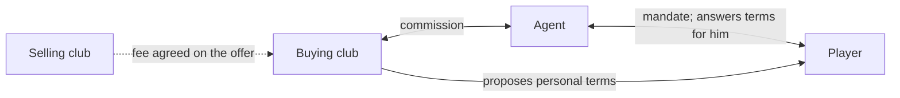

# Workflow: Agent Representation

## Purpose

Describes how an agent's representation of a player (a mandate) affects and participates in the deal lifecycle.

## Scope

In scope: mandates, the agent's commission negotiation with the buying club, and how these connect to the wider deal.
Out of scope: personal terms, which are captured once at `PERSONAL_TERMS` regardless of whether a mandate exists (see [`transfer-lifecycle.md`](./transfer-lifecycle.md) and [ADR 0002](../decisions/0002-single-capture-point-for-personal-terms.md)); the rest of the deal lifecycle outside the agent-negotiation stage (see [`transfer-lifecycle.md`](./transfer-lifecycle.md)).

## Table of Contents

- [Mandates](#mandates)
- [Agent negotiation](#agent-negotiation)
- [Diagram](#diagram)
- [Related documents](#related-documents)

## Mandates

A mandate is the formal relationship between an agent and a player — it establishes who represents whom, whether exclusively, and for how long.

**How it's set up.** The agent creates a mandate for a player (`POST /mandates/`). It holds a start and end date, whether it's exclusive, and a territory.
- **No player confirmation.** A mandate is `ACTIVE` as soon as it's created; the player isn't asked to confirm it. This is a known gap (TRA-144; [permissions model](../../security-and-compliance/permissions-model.md#known-gaps)).
- **Ending.** The agent can revoke it, and a daily job expires it after its end date.

**What it authorises**
- **Deals start with the agent.** A deal for a mandated player starts at `AGENT_NEGOTIATION`, and the agent is invited into the deal room.
- **Commission.** The agent negotiates commission with the buying club.
- **Personal terms.** The agent proposes the player's terms, and can answer them for the player whether or not the player has an account ([ADR 0007](../decisions/0007-players-join-by-invitation-agents-can-answer.md)).
- **Free agents.** The agent can invite a free-agent client to TransferX.
- **Alerts.** The agent gets client alerts (contract expiry, valuation change, club interest) every six hours.

**Demo data.** Every contracted player and free agent has an agent: `scripts/allocate_players_to_agents.py` shared players across the demo agents with two-year exclusive mandates.

## Agent negotiation

When a deal reaches the `AGENT_NEGOTIATION` stage (see [`transfer-lifecycle.md`](./transfer-lifecycle.md)), the mandated agent negotiates **commission terms** with the buying club — percentage, flat amount (auto-derived from the percentage against the deal's agreed fee if only a percentage is given), and who pays it.

As of [ADR 0002](../decisions/0002-single-capture-point-for-personal-terms.md), this stage no longer also negotiates personal terms — those are captured once, at `PERSONAL_TERMS`, whether or not an agent is involved. The agent still runs that step too when mandated (proposing terms via `set_personal_terms`), it's just a separate stage rather than a parallel track here.

The club must agree before the deal can advance; declining collapses the deal.

The agent and the buying club exchange proposals and messages in the deal room's negotiation panel (`/negotiations`). Each side sees its own and the other's commission terms. The player doesn't see commission. Agents start on their **Pipeline** page, which lists every client deal waiting on them.

## Diagram

## Related documents

- [`transfer-lifecycle.md`](./transfer-lifecycle.md) — where this stage fits in the overall deal
- [`deal-completion.md`](./deal-completion.md) — what happens after agent negotiation concludes
- [`../../business/glossary.md`](../../business/glossary.md) — definition of Mandate
